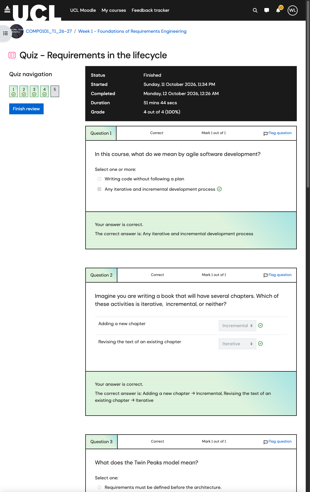
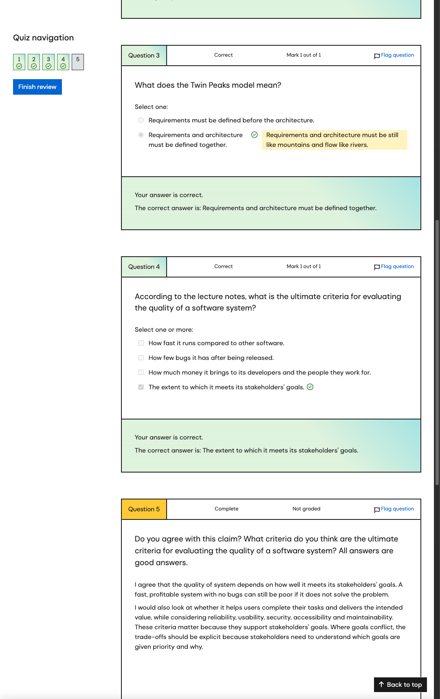
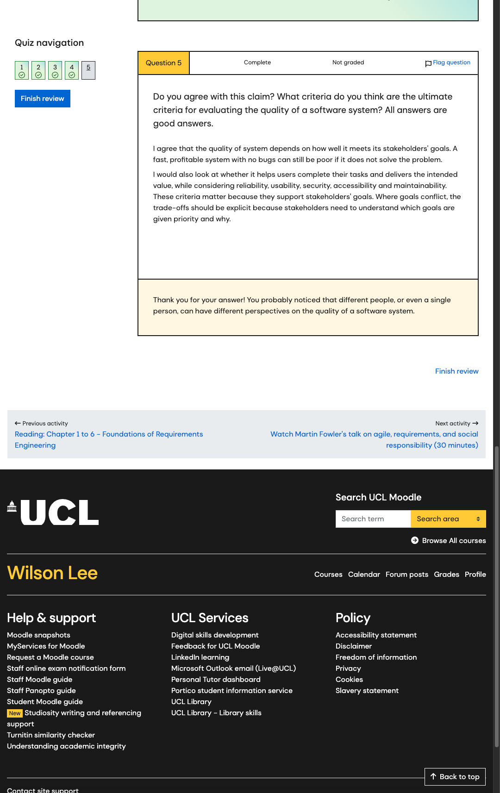

# COMP0101 — Week 1 Coursework, Reading and My Answers

[繁體中文版](../README.md) · [Weekly lecture notes in English](../../dict/README.md) · [Moodle Week 1](https://moodle.ucl.ac.uk/course/section.php?id=1379384)

Checked on **12 October 2026, Europe/London**. This file distinguishes Moodle instructions, my completion records and suggested study approaches. Personal status and “my answers” refer to the repository owner, not every reader. No Moodle assignment or quiz was submitted as part of preparing these notes.

## 1. Weekly Tasks and Suggested Order

| Order | Task | Required / grading | Deadline / target | Verified status |
|---|---|---|---|---|
| 1 | Read Chapters 1–6, especially Chapters 5 and 6 | Required; material not covered fully in class could be assessed | Before the morning class on 15 October; suggested target: afternoon of 14 October | Reading completion not confirmed; the old book link is unavailable. |
| 2 | Quiz — Requirements in the lifecycle | Chapter 5 self-check; pass 4/4; not the source of the module's final mark | Same pre-class requirement; no separate hard quiz deadline was found | **Completed: Finished, 4/4 (100%).** |
| 3 | Radiation Therapy Controller exercise | Not marked, but requires a genuine attempt; exam-like practice | Same pre-class requirement | **Not submitted**; Moodle shows no submissions. |
| 4 | Upload RTC answers → compare solution → correct mistakes | Submission unlocks the solution sheet and exercise forum | Complete and correct before class | Not yet done; no personal RTC answers are available to include. |
| 5 | Martin Fowler talk, approximately 30 minutes | **Optional but highly recommended** | This week's supplementary study time | Viewing status not confirmed. |
| 6 | Preview context diagrams / domain conceptual models | The 9 October announcement welcomes advance reading | Before 15 October, if time permits | Not confirmed. |

**Deadline sources and conflict:** The lecturer's [9 October 2026 announcement](https://moodle.ucl.ac.uk/mod/forum/discuss.php?d=1316380#p2355911) requires Week 1 tasks before the next Thursday morning class, meaning **before the morning class on 15 October 2026**. The morning class also suggests submission on Wednesday afternoon, so **the afternoon of Wednesday 14 October** is a suggested target allowing time for corrections, without a precise clock time. The RTC page still shows **9 October 2025, 09:00**, calculating a year of lateness. This old date conflicts with the current-year announcement and should not be taken as the current deadline being a year overdue.

## 2. Read Chapters 1–6: What and Where

Official route: **Moodle → COMP0101 → Week 1 → Your Tasks For Next Week → Reading: Chapter 1 to 6 — Foundations of Requirements Engineering**.

- [Reading activity](https://moodle.ucl.ac.uk/mod/url/view.php?id=8513323): Moodle explicitly requires Chapters 1–6, particularly Chapters 5 and 6, which were not fully covered in class.
- The old [lecture-notes book](http://www0.cs.ucl.ac.uk/staff/E.Letier/book/) could not be opened. The same link appears in Moodle General and the 9 October announcement.
- The available [Foundations of Requirements Engineering slides](https://moodle.ucl.ac.uk/mod/resource/view.php?id=8513321), `1. Foundations.pptx`, can support concept review and practice, but do not establish completion of the book reading.
- [Moodle General Reading List](https://moodle.ucl.ac.uk/course/view.php?id=56463) provides further books. The lecturer says books need not be bought and the entire reading list need not be read. The assigned Chapters 1–6 refer to these foundations lecture notes, not to Chapters 1–6 of any arbitrary book on the list.

**Suggested approach:** Use the [Week 1 notes](../../dict/README.md) to establish the concepts, then return to the course materials and explain the questions below in your own English. If the book remains unavailable, ask in class or office hours for an accessible copy. No message was sent as part of this review.

| Focus | Available slide sections | Self-check |
|---|---|---|
| Definition of RE | Slides 3–18 | Why is RE more than asking clients what they want? |
| World / Machine / Phenomena | Slides 19–31 | Can I classify W/I/O/M after stating the machine boundary? |
| G / R / D and correctness | Slides 32–50 | Can I explain `Req, Dom ⊢ Goals` and distinguish actual state from sensor data? |
| Requirements errors | Slides 51–69 | Can a system fail while the software meets its spec? Why? |
| Lifecycle | Slides 70–80 | Iterative vs incremental? Twin Peaks? Requirements and testing? |
| Wider context | Slides 81–96 | Client/product, brownfield, regulation, social responsibility, AI? |

This table is a guide to **slide sections**. It does not infer the formal chapter titles of the unavailable book.

## 3. Quiz — Requirements in the Lifecycle

[Quiz entry](https://moodle.ucl.ac.uk/mod/quiz/view.php?id=8513324) · [My finished attempt / feedback](https://moodle.ucl.ac.uk/mod/quiz/review.php?attempt=6460314&cmid=8513324)

**Confirmed on Moodle:** Attempt 1, Finished; completed at **00:26 on 12 October 2026**; **4 out of 4 (100%)**; highest grade 4/4. The grading method is Highest grade and the pass threshold is 4/4. Four objective questions are worth one mark each; the fifth reflection is Not graded. Moodle's Done condition is receiving a grade. The actual score was checked separately rather than inferred only from the completion badge.

### Q1 — Agile Software Development

**Question:** In this course, what do we mean by agile software development?

**My submitted answer:** Any iterative and incremental development process.

**Feedback:** Correct, 1/1.

**Explanation:** Iterative development improves existing content; incremental development adds deliverable content. Agile still requires vision, planning, collaboration and engineering discipline. It does not mean writing code without following a plan.

### Q2 — Iterative vs Incremental

**Question:** Imagine you are writing a book that will have several chapters. Which of these activities is iterative, incremental, or neither?

| Activity | My submitted answer | Moodle feedback |
|---|---|---|
| Adding a new chapter | **Incremental** | Correct |
| Revising the text of an existing chapter | **Iterative** | Correct |

Question total: **1/1**. Memory aid: add new = incremental; improve existing = iterative.

### Q3 — Twin Peaks Model

**Question:** What does the Twin Peaks model mean?

**My submitted answer:** Requirements and architecture must be defined together.

**Feedback:** Correct, 1/1.

**Explanation:** This does not require both documents to be written at the same instant. Requirements and architecture influence each other and develop iteratively. Architecture can expose costs, constraints, omissions and new possibilities.

### Q4 — Ultimate Quality Criterion

**Question:** According to the lecture notes, what is the ultimate criteria for evaluating the quality of a software system?

**My submitted answer:** The extent to which it meets its stakeholders' goals.

**Feedback:** Correct, 1/1.

**Explanation:** Speed, few bugs and profitability can matter, but they must be related to stakeholder goals. A technically excellent system that fails to solve the actual problem may still be a poor-quality outcome.

### Q5 — My Reflection (Not Graded)

**Question:** Do you agree with this claim? What criteria do you think are the ultimate criteria for evaluating the quality of a software system? All answers are good answers.

The supplied English answer is preserved below. The same text was verified in Moodle review, with status **Complete / Not graded**:

> I agree that the quality of system depends on how well it meets its stakeholders' goals. A fast, profitable system with no bugs can still be poor if it does not solve the problem.
>
> I would also look at whether it helps users complete their tasks and delivers the intended value, while considering reliability, usability, security, accessibility and maintainability. These criteria matter because they support stakeholders' goals. Where goals conflict, the trade-offs should be explicit because stakeholders need to understand which goals are given priority and why.

**Explanation:** The answer first agrees that stakeholder goals are the ultimate criterion, then explains how reliability, usability, security, accessibility and maintainability support those goals. Conflicts require explicit priorities and reasons. This is my answer, not a claim to be the only model answer.

### Screenshots — Finished Attempt

These original PNG screenshots were captured directly from the completed Moodle attempt review on **12 October 2026, Europe/London**, without the mouse pointer. Together, the three images preserve the **4/4 grade, Q1–Q5 answers and feedback**.

#### Grade and Q1–Q2

[Open full-resolution screenshot](../images/lifecycle-quiz-grade-q1-q2.png)

#### Q3–Q4

[Open full-resolution screenshot](../images/lifecycle-quiz-q3-q4.png)

#### Q5 — Complete / Not graded

[Open full-resolution screenshot](../images/lifecycle-quiz-q5.png)

### Will the Quiz Be Examined?

Moodle describes the quiz as a check of Chapter 5 understanding, and says required reading could be assessed. **Agile, iterative/incremental development, Twin Peaks and stakeholder goals therefore need to be understood.** No announcement guarantees that these five questions will appear unchanged in the final examination or that the quiz contributes to the COMP0101 final mark.

The lecturer's statements about exam-like questions and former exam questions concern weekly exercise sheets generally. They do not establish that every quiz question belongs to a final-exam question bank.

## 4. Radiation Therapy Controller (RTC) Exercise

[Assignment entry](https://moodle.ucl.ac.uk/mod/assign/view.php?id=8513326) → download **`1. Foundations-RTC.docx`**.

### 4.1 Understanding the Problem

The machine is the **Radiation Therapy Controller (RTC) software**, not the entire **Radiation Therapy Machine (RTM)** or hospital.

RTC reads a doctor's prescription from an external prescription database. The therapist selects a prescription at the RTC workstation and directly adjusts RTM settings and the patient's position at the RTM. RTC can **sense settings but not control settings**. It checks actual settings against prescribed settings, controls its own interlock switch, displays readiness and writes to an external radiation-session database.

The START/STOP control panel connects directly to an RTM switch; RTC only senses that switch's status. The beam also depends on interlock switches controlled by the dosimeter and other safety software or hardware. Do not assume that RTC alone controls whether the beam is on or directly moves the patient or adjusts the RTM.

Normal scenario: select prescription → display settings → therapist adjusts RTM → settings match → RTC closes its switch / indicates ready → therapist leaves the room / presses START → beam on → prescribed dose reached / beam off → RTC logs the session. Read the exceptions too: early STOP, other interlocks opening, and the prohibition on changing patient/prescription while the beam is on.

### 4.2 How to Approach Each Question — Guidance, Not My Submitted Answers

| Question | Task | Approach and checks |
|---|---|---|
| Q1 — Actors and Stakeholders | For nine terms, fill Actor Y/N and Stakeholder Y/N. | Check ability to act/change state and whether it is an affected person/group. Do not automatically treat an entity, prescription or session as an actor. |
| Q2 — Phenomena | Classify scenario phenomena as W/I/O/M, using the most specific category. | State machine = RTC, then locate each event and its controller using the context diagram. Direct therapist–RTM interaction is not automatically RTC input. |
| Q3 — Domain Goals | Compare G1 Achieve [Radiation Session Delivered] and G2 Avoid [Incorrect Radiation Delivery]; find behaviours satisfying one but not the other; list the world phenomena. | Separate eventual delivery from avoiding incorrect delivery. Use concrete sequences to test whether the properties are equivalent. |
| Q3 optional subquestion | Express Achieve/Avoid patterns in temporal logic. | **Optional; formal specification is not assessed.** Attempt if time permits to deepen understanding of phenomena and properties. |
| Q4 — G / D / R | Classify properties with IDs 3–9, and list I/O phenomena for each R. | Look beyond keywords. Ask whether RTC itself can guarantee the property or whether it assumes therapist, RTM or hardware behaviour. |
| Q5 — Requirements Correctness | List domain assumptions D and machine requirements R contributing separately to G1 and G2. | Explain how D and R jointly support each goal and include only relevant items. Do not omit assumptions about external behaviour, sensors or interlocks. |

**Minor numbering errors in the sheet:** Q3 uses 2.x subquestion numbers, including a repeated 2.2. Q5's second subquestion is printed as 5.12 and its last sentence refers again to items not contributing to G1. Its first part explicitly requests `D, R ⊢ G2`; it can be interpreted for G2 with that interpretation noted in the answer, while still checking with the lecturer.

### 4.3 Submission and Corrections

1. Label Q1–Q5 in the downloaded sheet or your own answer document and make a genuine attempt.
2. If stuck, write a short note explaining the difficulty or uncertain assumptions. Moodle permits blanks, but an explanation is more useful.
3. Open the [RTC assignment](https://moodle.ucl.ac.uk/mod/assign/view.php?id=8513326), select **Add submission**, upload your answers and **Save changes**. Check Submission status for an actual submission record. If the form additionally requires **Submit assignment**, complete that step rather than remaining in Draft. No submission was made during this review, and an additional button is not assumed to exist. Previously visible limits were one file and 500 MB; no exclusive extension requirement was seen, so follow the current form.
4. Return to Week 1 and open the unlocked **Week 1 Exercise: Solution Sheet**. Compare each answer.
5. Record classification errors, missing assumptions and reasoning problems in your corrections rather than only reading the solution.
6. For remaining questions, use the unlocked **Week 1 Exercise Forum**, class or office hours.

**Current state:** Moodle shows **No submissions have been made yet / Not graded**. No personal RTC answers are available to record, and the restricted solution sheet has not been opened. `Not marked` does not mean unnecessary. The lecturer explicitly requests a first attempt to avoid the false confidence of understanding a solution without being able to solve the question independently.

## 5. Optional Work and Exam Relevance

| Item | Lecturer / Moodle rule | Suggested scheduling |
|---|---|---|
| Weekly exercise sheet | Not marked; many questions are exam-like; some were exam questions; a genuine attempt and upload are still required before class. | Treat as core weekly work and correct it after submission. |
| RTC formal specification | Optional; explicitly not assessed on formal specification. | Complete core classification and reasoning first; use this for deeper understanding if time permits. |
| Martin Fowler talk | Optional but highly recommended; approximately 30 minutes. | Watch after core reading and RTC. |
| Chapters 5 and 6 | Required reading; could be assessed despite not being fully covered in class. | Read independently; do not skip because class coverage was brief. |
| Lifecycle Quiz | Short Chapter 5 self-check; pass 4/4. | Already completed by the repository owner; be able to explain the answers when revising. |

COMP0101's final assessment is a **three-hour written examination worth 100%**. Past papers are available through [Moodle General](https://moodle.ucl.ac.uk/course/view.php?id=56463) → Library links → [COMP0101 Past exam papers](https://ucl.primo.exlibrisgroup.com/discovery/search?query=any%2Ccontains%2Ccomp0101&tab=Exampapers&search_scope=Exampapers&vid=44UCL_INST%3AUCL_VU2&offset=0). The lecturer says the format is similar while content changes each year; exercises are not a guarantee of repeated questions.

## 6. Sources

- [Moodle My courses](https://moodle.ucl.ac.uk/my/courses.php) → [COMP0101](https://moodle.ucl.ac.uk/course/view.php?id=56463) → [Week 1](https://moodle.ucl.ac.uk/course/section.php?id=1379384).
- [Reading](https://moodle.ucl.ac.uk/mod/url/view.php?id=8513323), [Foundations slides](https://moodle.ucl.ac.uk/mod/resource/view.php?id=8513321), [optional Fowler talk](https://moodle.ucl.ac.uk/mod/url/view.php?id=8513325).
- [Lifecycle Quiz](https://moodle.ucl.ac.uk/mod/quiz/view.php?id=8513324) and read-only [completed attempt review](https://moodle.ucl.ac.uk/mod/quiz/review.php?attempt=6460314&cmid=8513324), with original Q1–Q5 screenshots embedded in this file.
- [RTC assignment](https://moodle.ucl.ac.uk/mod/assign/view.php?id=8513326) and the read exercise sheet `1. Foundations-RTC.docx`.
- [9 October 2026 Week 1 Reading and Exercises announcement](https://moodle.ucl.ac.uk/mod/forum/discuss.php?d=1316380#p2355911).
- [Asksia original class sources](https://app.asksia.ai/pro/session?id=32744d41-52e6-4ccd-847e-d63797c258a3): `Recording_20261008_0800` / `Recording_20261008_1609`. Reading coverage and ASR limitations are documented in the [weekly notes](../../dict/README.md#11-sources-and-coverage).
