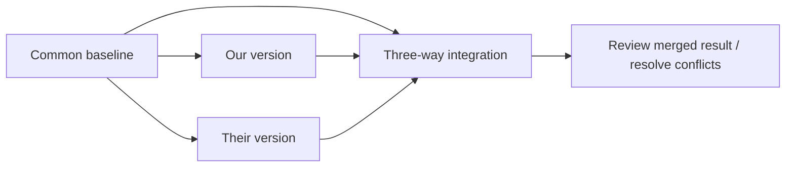

# COMP0104 Week 1 — Managing Changes and Centralised Version Control

> 整理範圍：2026-10-05–2026-10-11；來源核對日：2026-10-12（Europe/London）。English technical terms 為主，繁中說明。這是個人統整筆記，不是逐字稿或講義全文。

## Source coverage

| Source | 閱讀／核對範圍 | 限制 |
|---|---|---|
| [Asksia recording](https://app.asksia.ai/pro/session?id=3bd60296-5b67-4179-8aa4-b35faafdcde0)，`Recording_20261006_1404` | 英文原始逐字稿逐段讀取 **0:00–108:15**；主要授課到約 103:06，之後是收會對話 | 錄音開頭已在解釋 edit-distance matrix，缺少此前的開場／內容；不能據此宣稱涵蓋所有 Week 1 上課時段。ASR 有斷句、專有名詞誤辨，無法可靠重建的內容不補成引言或問答。 |
| 同一 recording 的既有 **Sia Note** | 在完成原文分析後，核對重點、概念、exam traps、Q&A | 只作第二次核對；下方記錄已發現的摘要錯誤。 |
| [Moodle Week 1](https://moodle.ucl.ac.uk/course/section.php?id=1379313)、[Labs](https://moodle.ucl.ac.uk/course/section.php?id=1379312)、[module overview](https://moodle.ucl.ac.uk/course/view.php?id=56459) | 學習目標、必讀／額外閱讀、formative activities、Lab 規則及 completion 狀態 | 原始 slides 的內容未全部取得，見下方資料表。 |
| [Lab 1](https://moodle.ucl.ac.uk/mod/resource/view.php?id=8512843)、[Lab 2A](https://moodle.ucl.ac.uk/mod/resource/view.php?id=8512848) | 兩份 PDF 各 **6 頁**的題目、操作要求、反思及 checkpoint | 只整理要求與概念；未執行練習，未代寫個人反思。PDF 封面 ©2025 是教材版權年，不能當作本年度 deadline。 |
| [Required Reading](https://moodle.ucl.ac.uk/mod/url/view.php?id=8512850) | 官方英文書籍 **Preface**（技術／閱讀導引部分）、**Chapter 1**、**Chapter 2** | Moodle 連到書籍首頁；本次使用首頁列出的穩定 **Subversion 1.7** HTML 版。它是版本指定文件，命令細節需配合實際安裝版本。 |

## Weekly summary

本週的主線是：**identify changes → represent changes → integrate changes → coordinate and recover versions**。`diff` 找出兩份文字的差異，`patch` 重播變更，three-way integration 加入共同基準以區分兩邊的修改；SVN 再把這些能力放進多人協作的 repository / working-copy workflow。

課堂先延續 shortest edit sequence 的演算法，然後介紹 Software Configuration Management、centralised VCS、SVN revisions 與 working-copy states，再討論 branching、release policies、cherry-picking 與 configuration。課尾以歷屆題型檢查 two-way / three-way integration 的理解。

Moodle 將 Lab worksheets、短 quiz（如有）及 PeerWise 放在 **formative learning** 中；Lab sessions 和 worksheets 明確 **not assessed**。不計分仍值得完整嘗試，因為口頭練習直接對應考試會要求的解釋與推理。實際本週待辦與期限集中在 [coursework checklist](coursework/README.md)。

## Key Concepts

### 1. Diff, edit distance and shortest edit sequence

**課堂依據：0:00–10:23、84:52–85:41。**

- 本課使用 **insert / delete** 模型：修改一個元素視為一次 deletion 加一次 insertion，成本 **2**；不要默認 substitution 的成本是 1。
- `D(i,j)` 表示兩個 prefixes 之間的最短編輯成本。由左方／上方增加一次操作得到的是 **upper bound**，不是必定相等；還需要比較其他路徑。
- 對應元素相同時，可走 diagonal match，不增加成本。記下 predecessor arrows，最後 backtrack 得到實際 edit sequence。
- 最短成本不代表只有一種最短路徑。不同 tie-breaking / algorithms 可能產生不同但同樣最短的 diff。
- 課堂以完整 DP matrix 說明基本模型；9:51 附近指出 quadratic complexity。實務工具會用 heuristics / optimisations；不要把老師對實務速度的描述當作所有輸入都有 linear worst-case complexity 的保證。
- 7:49–8:18 的重點是 **minimality 與 readability 的取捨**：較短的 diff 不一定最好理解。

**整理補充（不是教授原句）：** 若 `a` 在列、`b` 在欄，insert/delete-only 的概念 recurrence 可寫為：

```text
D(0,j) = j; D(i,0) = i
D(i,j) = min(
  D(i-1,j) + 1,                 // delete
  D(i,j-1) + 1,                 // insert
  D(i-1,j-1) if a[i] == b[j]   // match；不同時不能免費走 diagonal
)
```

例如將 `cat` 變成 `cut`，在此模型需要刪除 `a`、插入 `u`，成本 2。這是說明模型的自製例子，不是 Lab 的完成答案。

### 2. Two-way integration versus three-way integration

**課堂依據：7:05–7:31、85:56–88:53、90:42、95:28–95:49、98:30–102:22。**

| Model | Inputs | 能判斷什麼 | 主要限制 |
|---|---|---|---|
| **Two-way integration** | 兩個目前版本 | 比較不同區域並決定採用哪份文字 | 沒有共同 baseline，不能單靠這兩份文字判定哪方引入修改。 |
| **Three-way integration** | baseline + ours + theirs | 分別推導兩邊相對 baseline 的變更；單邊修改常可自動保留 | 互相重疊／不相容的修改需要 resolution；不保證 semantic correctness。 |

87:37–87:46 特別提醒 **original version 的說法可能含糊**：baseline 不是一定指 repository 的「第一版」。在 branch history 中，應找適當的 **nearest common ancestor**（68:02–69:25）。



**Lab 1 的補充提醒：** `diff3 -m ours base theirs` 的參數位置有意義；`-m` 輸出 merged text 到 stdout，不會自行修改 input files。兩次修改即使在不同 lines，若位置相鄰仍可能產生 conflict；不能將「不同 line」當作必然無衝突的保證。

### 3. Software Configuration Management (SCM)

**課堂依據：19:04–25:15。**

SCM 管理 evolving systems。課堂的三個目標是：

1. **Restore previous configurations**：能重建客戶正在用的版本，分析問題，而不是只叫客戶升級碰碰運氣。
2. **Coordinate changes**：多人修改相同 artifacts 時避免無意覆蓋或遺失變更。
3. **Identify versions of components**：知道特定 release 由哪些 component versions 組成，也可透過 tags 更容易定位。

一般 file synchronisation 不等於版本控制的協作模型。能把資料同步到另一台電腦，並不代表已理解兩邊的 changes、conflicts 和歷史。

### 4. Revision, variant, branch, tag and configuration

**課堂依據：25:15–26:31、55:47–57:49、77:20–81:06。**

| Term | 本週理解 |
|---|---|
| **Revision** | 沿時間線的 successive state；新版本取代先前版本。 |
| **Variant** | 並行的 alternative；課堂以 branch 作主要例子。 |
| **Trunk** | Main line of development；也是一條 development line。 |
| **Branch** | 將某組開發活動暫時隔離，之後可 integrate。 |
| **Tag** | 對某個 snapshot 的易讀名稱，例如 release 名稱。 |
| **Configuration** | 在共同 code base 上透過 build/runtime choices 產生不同產品行為。 |

課堂提醒不要把每個 platform / country / feature combination 都做成長期分支；C/C++ preprocessor 和 runtime feature switches 是 configuration 的例子。此處是課堂的設計取向，不是「所有 branch 必須短期存在」的工具限制。

**Required Reading 補充：** SVN 的 revision number 是 **repository-wide**，選出整棵 tree 的狀態，不是每個 file 自己獨立的版本號。兩個 repository revisions 中，同一檔案內容可能完全一樣。Working copy 可以是 **mixed-revision**；`commit` 不會自動替所有其他檔案做 `update`。

### 5. Centralised version control and SVN work cycle

**課堂依據：26:42–34:25、39:31–52:16；Required Reading Chapters 1–2。**

Repository 保存版本歷史；working copy 是可以編輯／編譯的私人工作區。`checkout` 建立工作副本，`update` 接收 repository 的變更，`commit` 才將本機變更寫入 repository。

```text
checkout → update → edit → status / diff → update if needed
         → resolve + verify → commit
```

老師以兩種 concurrency models 比較：

- **Pessimistic / lock-modify-unlock**：先鎖住，避免其他人同時改；忘記 unlock、放假等會阻塞協作。
- **Optimistic / copy-modify-merge**：各自修改 private copies，再 integrate；大多數不重疊的文字修改可合併。

Required Reading 也指出 binary / nonmergeable files 仍可能需要 locks；「SVN 主要採 optimistic」不代表完全沒有 locking 功能。任何模型都不能取代團隊溝通或保證不同檔案間的 semantic compatibility。

#### Four working-copy states

**課堂依據：44:22–46:52；SVN book Chapter 1。**

| Local state | Repository state | 意義與下一步 |
|---|---|---|
| Unchanged | Current | 無需提交；update 對此檔案沒有新變更。 |
| Locally changed | Current | 可 review、verify 後 commit。 |
| Unchanged | Out of date | update 取回新版本。 |
| Locally changed | Out of date | 不能直接 commit；先 update，必要時 resolve three-way merge，再驗證。 |

`svn status` / `svn diff` 預設主要檢查 working copy 與其 cached base；要知道 repository 是否有新變更，需如 `svn status -u` 的查詢。`-v` 的 **working revision** 與 **last-changed revision** 也要分清（48:54–50:52）。

**Atomic commit**（39:49–40:27）：同一次 transaction 的 changes 全部接受或全部不接受。這不表示 commit 的程式一定能 build 或沒有 bug；功能驗證仍由開發者負責。

### 6. Branching, release policies and cherry-picking

**課堂依據：60:01–77:12。**

- **Unstable trunk / trunk-based**：持續在 trunk 上改動；快速發布需要相應的驗證與操作措施。
- **Stable trunk**：在 branches 工作，完成後才 merge 回 trunk。
- **Semi-stable trunk**：混合模式；多數變更在 trunk，部分工作隔離。
- **Release branch**：穩定將發布的版本；可在 trunk 繼續 features，release branch 專注 bug / stabilisation fixes。
- **Code freeze**：只允許經批准的重要變更；課堂用歷史 release-planning 圖作例子，圖上的年月不是本人的作業期限。
- **Cherry-picking**（70:24–74:13）：把選定 change set 套用到另一 development line，而不是把整條 branch 的所有進展都 merge 過去。73:17–73:37 提醒：某個 bug fix 可能依賴另一個 change，單獨移植未必可用。

**整理補充：** 課堂在概念上把「選定變更重播」與「利用共同祖先推導 merge」分開；不要把這種比較解讀成所有工具的 cherry-pick 內部實作都不會使用 three-way merge。

### 7. AI-assisted development still requires evidence

**課堂依據：52:27–55:36；Lab 1 Part II；Lab 2A Exercise 9。**

老師提到 AI 可協助 commit messages、conflict resolution、grouping changes，但 53:45–54:14 提醒 commit message 可能混入整段工作／對話的印象，未忠實反映最後 diff。

54:46–55:21 的原則是 **smallest practical commits，each commit one task**。先看實際變更再決定如何分組，不能只接受 AI 的描述。Lab 將此落實為：保留 command output、自己的 manual resolution、所評估的 AI 或 supplied response，以及必要的 corrections。

## Professor's exam traps and practical reminders

| Reminder | Evidence |
|---|---|
| 左／上鄰格 +1 是 **at most**，不要硬填成 equal。 | 0:00–2:06 |
| 最短 edit sequence 可能有多個；看到不同 diff 不一定誰錯。 | 4:54–5:50 |
| 本課 change = delete + insert，不能改成成本 1 的 substitution。 | 84:52–85:41 |
| Three-way 的 baseline 不是必然最早版本。 | 87:37–87:46；68:02–69:25 |
| 有 textual merge 成果，不代表 semantic correctness；要 review／test。 | Required Reading Chapter 1；Lab 1 Exercise 5 |
| commit、update、status 是不同操作；本機改動不會自動發布。 | 29:20–31:07；44:22–52:05 |
| 查歷史時注意 working revision；回到舊 revision 不等於 undo 已提交的 repository history。 | Required Reading Chapters 1–2；Lab 2A Exercise 6 |
| 回答要覆蓋題目的各個部分，依 marks 控制長度；不需為短題重做未被要求的 matrix。 | 94:00–95:16；98:39–100:25 |
| Handwritten answer 必須 readable、English；bullet points 可以，不要求漂亮的敘事。 | 95:59–97:38 |
| 部分 seminar solutions 會在授課後加上，不要把未先提供答案誤認為缺少題目。 | 102:32–102:45 |

94:16–94:23 的口頭說明提到 two-hour exam；這是本堂課的描述，正式日期、地點、時長及評量比例仍以 module assessment information / exam timetable 為準。本週 Moodle overview 未列出具體比例，因此此筆記不自行寫成「100% exam」。

## Actual classroom Q&A / prompts

以下只列能由錄音辨識的問答；學生聲音不完整的地方不替學生編寫問題。

| Time | Type | Question / prompt（英文整理） | Recorded answer／討論 |
|---|---|---|---|
| 12:37–18:54 | Lecturer prompt | **Why cover Subversion before Git?** | 用較簡單的 centralised model 教基本協作、trunk-oriented workflow，再引入 distributed model；避免一開始就被 Git 的額外概念淹沒。課堂公司案例／數字的 ASR 不穩定，未當作可驗證的產業統計。 |
| 68:02–69:25 | Lecturer prompt | **Which revision is the baseline for the next merge?** | 沿 history 找 nearest common ancestor；在曾 merge 過的情況，不能永遠使用原始 branch point。 |
| 69:54–74:13 | Lecturer prompt | **Is taking this particular bug fix two-way or three-way integration?** | 老師將圖中操作辨識為 cherry-picking：移植選定 change set，並討論 dependency。 |
| 84:52–85:41 | Class poll / clarification | **Do insert/delete distance and insert/delete/change distance mean the same thing?** | 不是默認相同；本課 change 以 delete + insert 計兩次，不採替換一次的變體。 |
| 85:56–87:56 | Class poll / clarification | **Which description of three-way integration is not true?** | 僅比較兩份新檔是 two-way；three-way 還有 baseline。「original」一字可能使人誤解成第一版。 |
| 95:59–97:38 | Audible student question | **Would you accept bullet points rather than full sentences?** | 可以；內容需 readable，清楚覆蓋所需答案，手寫英文可讀即可。 |
| 102:31–102:45 | Student question未完整收錄，僅回答可辨識 | 未重建題目 | 老師說會在課後加入解答，不在講座前放出。 |

## Sia Note cross-check and corrections

原文先分析、摘要後核對。摘要與原文在 DP、SCM、small commits、release workflow 等主線一致，但以下不能直接採信：

| Sia Note 的問題 | 本筆記的修正依據 |
|---|---|
| Q&A 把 three-way 的 original version 寫成 **the very first version**。 | 87:37–87:46 其實在指出這個詞有歧義；68:02–69:25 明確討論 nearest common ancestor。 |
| 「Comparison of two versions requires a common original baseline」措辭混淆 two-way 與 three-way。 | 95:28–95:49：two-way 可比較兩個目前版本，但無法識別哪方引入 change。 |
| Version / file state 概念列出 **staged / committed**。 | 本堂 SVN 四狀態是 local changed/unchanged × current/out-of-date；不可直接套 Git index 的分類。 |
| 將三段模糊對話全部標成 student questions。 | 本筆記分辨 lecturer prompts、class poll、可辨識的學生問句；不把 ASR 碎片改寫成實際問答。 |

## Moodle materials and reading map

| Material | Purpose / status |
|---|---|
| [Seminar Slides](https://moodle.ucl.ac.uk/mod/resource/view.php?id=8512838) | 歷屆題型／課堂練習的入口；本次未取得檔案正文。 |
| [Slides — Introduction](https://moodle.ucl.ac.uk/mod/resource/view.php?id=8512840) | Moodle A. Introduction；本次未取得檔案正文，錄音亦缺開場。 |
| [Slides — DIFF](https://moodle.ucl.ac.uk/mod/resource/view.php?id=8512842) | Moodle B. Managing Changes；PPTX 讀取導向受瀏覽器阻擋。本次以完整錄音和 Lab 1 核對相關概念，不宣稱讀過 PPTX。 |
| [Slides — SUBVERSION](https://moodle.ucl.ac.uk/mod/resource/view.php?id=8512847) | Moodle C. Version Control with Subversion；本次未取得檔案正文。 |
| [Required SVN reading](https://moodle.ucl.ac.uk/mod/url/view.php?id=8512850) / [English book 1.7](https://svnbook.red-bean.com/en/1.7/index.html) | **Preface + Chapters 1–2**；連到本筆記的 repository、atomic revisions、four states、work cycle、history、rename 概念。作者：Ben Collins-Sussman、Brian W. Fitzpatrick、C. Michael Pilato；依官方 CC BY 2.0 版閱讀後自行摘要。 |
| [Managing Changes reading list](https://moodle.ucl.ac.uk/mod/lti/view.php?id=9428318) | Miller and Myers, *A file comparison program*；在 **More Material and Training** 下，Moodle 明列 not required for the module。本次未讀文章全文。 |
| [SVN for Java Developers](https://moodle.ucl.ac.uk/mod/url/view.php?id=8512852) | 額外 LinkedIn Learning material，Moodle 明列 not required for the module；本次未觀看。 |

[Announcements](https://moodle.ucl.ac.uk/mod/forum/view.php?id=8512798) 在核對時沒有任何公告。不要替 Labs 推定 Moodle 未寫出的截止日。
