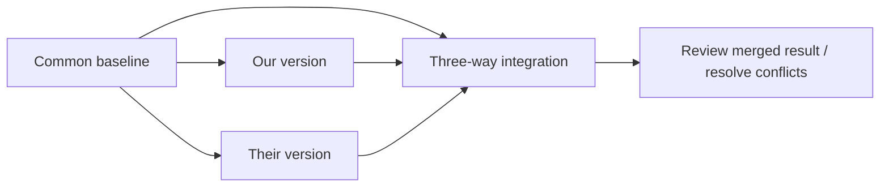

# COMP0104 Week 1 — Managing Changes and Centralised Version Control

[繁體中文版](../README.md) · [Coursework and practice checklist](../coursework/dict/README.md)

Personal completion status refers to the repository owner, not the reader.

> Scope: 2026-10-05–2026-10-11; sources checked on 2026-10-12 (Europe/London). This is the English translation of personal consolidated notes originally written with English technical terms and Traditional Chinese explanations. It is not a full transcript or a reproduction of the slides.

## Source coverage

| Source | Material read / checked | Limitations |
|---|---|---|
| [Asksia recording](https://app.asksia.ai/pro/session?id=3bd60296-5b67-4179-8aa4-b35faafdcde0), `Recording_20261006_1404` | The original English transcript was read section by section from **0:00–108:15**; the main teaching ends around 103:06, followed by conversation while closing the session. | The recording starts during an explanation of the edit-distance matrix; the preceding opening/content is missing. It therefore cannot establish coverage of every Week 1 teaching session. ASR contains broken sentences and misrecognised technical terms; passages that cannot be reconstructed reliably are not turned into quotations or Q&A. |
| The existing **Sia Note** for the same recording | Key points, concepts, exam traps and Q&A were checked after analysing the original transcript. | Used only as a second check; identified summary errors are recorded below. |
| [Moodle Week 1](https://moodle.ucl.ac.uk/course/section.php?id=1379313), [Labs](https://moodle.ucl.ac.uk/course/section.php?id=1379312), [module overview](https://moodle.ucl.ac.uk/course/view.php?id=56459) | Learning objectives, required/additional reading, formative activities, lab rules and completion status. | The original slides were not all obtained; see the materials table below. |
| [Lab 1](https://moodle.ucl.ac.uk/mod/resource/view.php?id=8512843), [Lab 2A](https://moodle.ucl.ac.uk/mod/resource/view.php?id=8512848) | Questions, operational requirements, reflections and checkpoints across **6 pages in each PDF**. | Only requirements and concepts were consolidated; exercises were not executed and personal reflections were not written on the author's behalf. The ©2025 on the PDF cover is the material's copyright year, not a deadline for this academic year. |
| [Required Reading](https://moodle.ucl.ac.uk/mod/url/view.php?id=8512850) | The official English book's **Preface** (technical material and reading guidance), **Chapter 1**, and **Chapter 2**. | Moodle links to the book's home page; this check used the stable **Subversion 1.7** HTML edition listed there. The documentation is version-specific, so command details must be matched to the installed version. |

## Weekly summary

The week's main progression is **identify changes → represent changes → integrate changes → coordinate and recover versions**. `diff` identifies differences between two texts, `patch` replays changes, and three-way integration adds a common baseline to distinguish the two sides' modifications. SVN places these capabilities within a collaborative repository/working-copy workflow.

The lecture continues the shortest-edit-sequence algorithm, then introduces Software Configuration Management, centralised VCS, SVN revisions and working-copy states. It moves on to branching, release policies, cherry-picking and configuration, before using past-exam-style questions to check understanding of two-way and three-way integration.

Moodle places lab worksheets, short quizzes (when offered), and PeerWise within **formative learning**; lab sessions and worksheets are explicitly **not assessed**. They are still worth attempting in full because the classroom exercises directly relate to the explanations and reasoning expected in the exam. The actual tasks and deadlines for the week are collected in the [coursework checklist](../coursework/dict/README.md).

## Key Concepts

### 1. Diff, edit distance and shortest edit sequence

**Lecture evidence: 0:00–10:23, 84:52–85:41.**

- The course uses an **insert/delete** model: changing an element is treated as one deletion plus one insertion, with a cost of **2**. Do not assume a substitution costs 1.
- `D(i,j)` represents the minimum editing cost between two prefixes. Adding one operation from the left/upper neighbour gives an **upper bound**, not necessarily an equality; other paths must also be compared.
- When the corresponding elements match, a diagonal match adds no cost. Record predecessor arrows, then backtrack to recover the actual edit sequence.
- A minimum cost does not imply a unique shortest path. Different tie-breaking rules or algorithms may produce different but equally minimal diffs.
- The lecture explains the basic model using a full DP matrix and identifies quadratic complexity around 9:51. Practical tools use heuristics/optimisations; the lecturer's description of practical speed is not a guarantee of linear worst-case complexity for all inputs.
- The point at 7:49–8:18 is the **trade-off between minimality and readability**: a shorter diff is not necessarily easier to understand.

**Study-note clarification (not the professor's wording):** With `a` along the rows and `b` along the columns, the conceptual recurrence for the insert/delete-only model is:

```text
D(0,j) = j; D(i,0) = i
D(i,j) = min(
  D(i-1,j) + 1,                 // delete
  D(i,j-1) + 1,                 // insert
  D(i-1,j-1) if a[i] == b[j]   // match; no free diagonal move if different
)
```

For example, changing `cat` into `cut` requires deleting `a` and inserting `u` in this model, for a cost of 2. This is an original example to explain the model, not a completed lab answer.

### 2. Two-way integration versus three-way integration

**Lecture evidence: 7:05–7:31, 85:56–88:53, 90:42, 95:28–95:49, 98:30–102:22.**

| Model | Inputs | What it can determine | Main limitations |
|---|---|---|---|
| **Two-way integration** | Two current versions. | Compare differing regions and decide which text to use. | Without a common baseline, the two texts alone cannot establish which side introduced a modification. |
| **Three-way integration** | baseline + ours + theirs | Derive each side's changes relative to the baseline; one-sided changes can often be retained automatically. | Overlapping/incompatible changes require resolution; semantic correctness is not guaranteed. |

At 87:37–87:46, the lecturer specifically warns that **“original version” can be ambiguous**: the baseline does not necessarily mean the repository's very first version. In branch history, find the appropriate **nearest common ancestor** (68:02–69:25).



**Additional reminder from Lab 1:** Argument positions in `diff3 -m ours base theirs` matter. `-m` writes the merged text to stdout; it does not modify the input files automatically. Even changes on different lines can conflict if they are adjacent, so “different lines” is not a guarantee of a conflict-free merge.

### 3. Software Configuration Management (SCM)

**Lecture evidence: 19:04–25:15.**

SCM manages evolving systems. The three goals discussed in class are:

1. **Restore previous configurations**: reconstruct the version a customer is using to investigate a problem, rather than simply asking them to upgrade and hope it disappears.
2. **Coordinate changes**: avoid accidental overwriting or loss when several people modify the same artifacts.
3. **Identify versions of components**: know which component versions form a particular release, with tags making those versions easier to locate.

Ordinary file synchronisation is not the same as version control's collaboration model. Synchronising data to another computer does not by itself establish an understanding of both sides' changes, conflicts and history.

### 4. Revision, variant, branch, tag and configuration

**Lecture evidence: 25:15–26:31, 55:47–57:49, 77:20–81:06.**

| Term | Understanding for this week |
|---|---|
| **Revision** | A successive state along a timeline; a new version replaces the previous one. |
| **Variant** | A parallel alternative; branches are the main classroom example. |
| **Trunk** | The main line of development; it is itself a development line. |
| **Branch** | Temporarily isolates a set of development activities that may later be integrated. |
| **Tag** | A readable name for a snapshot, such as a release name. |
| **Configuration** | Produces different product behaviour from a shared code base through build/runtime choices. |

The lecture cautions against making every platform/country/feature combination a long-lived branch. The C/C++ preprocessor and runtime feature switches are examples of configuration. This is a design preference discussed in class, not a tool restriction requiring every branch to be short-lived.

**Additional point from the Required Reading:** SVN revision numbers are **repository-wide**: they select the state of the entire tree, rather than independently numbering each file. A file may have identical contents in two repository revisions. A working copy can be **mixed-revision**; `commit` does not automatically `update` all its other files.

### 5. Centralised version control and SVN work cycle

**Lecture evidence: 26:42–34:25, 39:31–52:16; Required Reading Chapters 1–2.**

The repository stores version history; the working copy is a private workspace where files can be edited and compiled. `checkout` creates a working copy, `update` receives repository changes, and `commit` writes local changes to the repository.

```text
checkout → update → edit → status / diff → update if needed
         → resolve + verify → commit
```

The lecturer compares two concurrency models:

- **Pessimistic / lock-modify-unlock**: take a lock first to prevent concurrent editing; forgotten unlocks, holidays and similar situations can block collaboration.
- **Optimistic / copy-modify-merge**: modify private copies independently, then integrate them; most non-overlapping textual changes can be merged.

The Required Reading also explains that binary/nonmergeable files may still need locks. SVN's mainly optimistic approach does not mean it has no locking functionality. Neither model replaces team communication or guarantees semantic compatibility between different files.

#### Four working-copy states

**Lecture evidence: 44:22–46:52; SVN book Chapter 1.**

| Local state | Repository state | Meaning and next step |
|---|---|---|
| Unchanged | Current | Nothing to commit; update brings no new changes to this file. |
| Locally changed | Current | Review and verify, then commit. |
| Unchanged | Out of date | Update to receive the new version. |
| Locally changed | Out of date | Cannot commit directly; update first, resolve the three-way merge if necessary, then verify. |

By default, `svn status`/`svn diff` primarily examine the working copy against its cached base. To find out whether the repository has newer changes, use a query such as `svn status -u`. Also distinguish the **working revision** from the **last-changed revision** in `-v` output (48:54–50:52).

**Atomic commit** (39:49–40:27): all changes in the same transaction are accepted, or none are. This does not mean that the committed program necessarily builds or is bug-free; functional verification remains the developer's responsibility.

### 6. Branching, release policies and cherry-picking

**Lecture evidence: 60:01–77:12.**

- **Unstable trunk / trunk-based**: keep changing the trunk; rapid releases require corresponding verification and operational measures.
- **Stable trunk**: work on branches and merge back to the trunk once ready.
- **Semi-stable trunk**: a mixed model, with most changes on the trunk and some work isolated.
- **Release branch**: stabilise the version intended for release. Feature development can continue on the trunk while the release branch focuses on bug/stabilisation fixes.
- **Code freeze**: permit only approved important changes. The historical release-planning diagram used in class is an example; its dates are not the author's assignment deadlines.
- **Cherry-picking** (70:24–74:13): apply a selected change set to another development line, rather than merging all progress from an entire branch. The reminder at 73:17–73:37 is that a bug fix may depend on another change, so transplanting it alone may not work.

**Study-note clarification:** The lecture conceptually separates “replaying selected changes” from “deriving a merge using a common ancestor”. Do not interpret this comparison as a claim that no tool uses a three-way merge internally when implementing cherry-pick.

### 7. AI-assisted development still requires evidence

**Lecture evidence: 52:27–55:36; Lab 1 Part II; Lab 2A Exercise 9.**

The lecturer mentions AI assistance for commit messages, conflict resolution and grouping changes. However, at 53:45–54:14, he cautions that a commit message may reflect impressions from the entire work/conversation rather than faithfully describing the final diff.

The principle at 54:46–55:21 is **the smallest practical commits, with one task per commit**. Examine the actual changes before deciding how to group them; do not simply accept an AI description. The labs put this into practice by requiring command output, a personal manual resolution, the evaluated AI or supplied response, and any necessary corrections to be retained.

## Professor's exam traps and practical reminders

| Reminder | Evidence |
|---|---|
| Left/upper neighbour +1 is **at most**, not a value to fill in as an equality automatically. | 0:00–2:06 |
| Several shortest edit sequences may exist; different diffs do not necessarily mean one is wrong. | 4:54–5:50 |
| In this course, change = delete + insert; do not substitute a cost-1 replacement operation. | 84:52–85:41 |
| The three-way baseline is not necessarily the earliest version. | 87:37–87:46; 68:02–69:25 |
| A textual merge result does not guarantee semantic correctness; review/test it. | Required Reading Chapter 1; Lab 1 Exercise 5 |
| Commit, update and status are different operations; local edits are not published automatically. | 29:20–31:07; 44:22–52:05 |
| When examining history, consider the working revision. Returning to an older revision does not undo committed repository history. | Required Reading Chapters 1–2; Lab 2A Exercise 6 |
| Cover every part of the question and use the marks to control answer length. A short question does not require recomputing a matrix unless asked. | 94:00–95:16; 98:39–100:25 |
| Handwritten answers must be readable and in English. Bullet points are acceptable; polished narrative prose is not required. | 95:59–97:38 |
| Some seminar solutions are added after teaching; answers not supplied beforehand do not mean the questions are missing. | 102:32–102:45 |

The oral explanation at 94:16–94:23 mentions a two-hour exam. This is the description given in this lecture; the official date, venue, duration and assessment weighting remain subject to module assessment information/the exam timetable. The Week 1 Moodle overview did not state specific weightings, so these notes do not label the module “100% exam”.

## Actual classroom Q&A / prompts

Only questions and responses identifiable in the recording are included here. Questions are not invented to fill gaps in the students' audio.

| Time | Type | Question / prompt (consolidated in English) | Recorded answer / discussion |
|---|---|---|---|
| 12:37–18:54 | Lecturer prompt | **Why cover Subversion before Git?** | Use the simpler centralised model to teach basic collaboration and trunk-oriented workflows before introducing the distributed model, avoiding immediate overload from Git's additional concepts. ASR for the company examples/numbers is unreliable, so they are not treated as verified industry statistics. |
| 68:02–69:25 | Lecturer prompt | **Which revision is the baseline for the next merge?** | Follow the history to find the nearest common ancestor. After earlier merges, the original branch point cannot always be reused. |
| 69:54–74:13 | Lecturer prompt | **Is taking this particular bug fix two-way or three-way integration?** | The lecturer identifies the illustrated operation as cherry-picking: transplanting a selected change set, with dependencies discussed. |
| 84:52–85:41 | Class poll / clarification | **Do insert/delete distance and insert/delete/change distance mean the same thing?** | They are not automatically equivalent. In this course, a change counts as delete + insert, or two operations, rather than using a single-substitution variant. |
| 85:56–87:56 | Class poll / clarification | **Which description of three-way integration is not true?** | Comparing only two new files describes two-way integration; three-way also uses a baseline. “Original” can be misunderstood as the very first version. |
| 95:59–97:38 | Audible student question | **Would you accept bullet points rather than full sentences?** | Yes. The answer must be readable and clearly cover the required content; legible handwritten English is sufficient. |
| 102:31–102:45 | Student question not fully captured; only the response is identifiable | Question not reconstructed. | The lecturer says solutions will be added after class, rather than released before the lecture. |

## Sia Note cross-check and corrections

The original transcript was analysed first, then checked against the summary. They agree on the main themes of DP, SCM, small commits and release workflows, but the following points should not be accepted without correction:

| Problem in Sia Note | Basis for the correction in these notes |
|---|---|
| The Q&A describes the three-way “original version” as **the very first version**. | At 87:37–87:46, the lecturer is actually pointing out the word's ambiguity; 68:02–69:25 explicitly discusses the nearest common ancestor. |
| “Comparison of two versions requires a common original baseline” conflates two-way and three-way integration. | At 95:28–95:49: two-way can compare two current versions, but cannot identify which side introduced a change. |
| The version/file-state concept lists **staged / committed**. | The four SVN states in this lecture are locally changed/unchanged × current/out-of-date. Git's index categories cannot be applied directly. |
| Three ambiguous exchanges are all labelled student questions. | These notes distinguish lecturer prompts, class polls and identifiable student questions; ASR fragments are not rewritten as actual Q&A. |

## Moodle materials and reading map

| Material | Purpose / status |
|---|---|
| [Seminar Slides](https://moodle.ucl.ac.uk/mod/resource/view.php?id=8512838) | Entry point for past-exam-style questions/classroom exercises; the file contents were not obtained in this check. |
| [Slides — Introduction](https://moodle.ucl.ac.uk/mod/resource/view.php?id=8512840) | Moodle A. Introduction; the file contents were not obtained, and the recording also lacks the opening. |
| [Slides — DIFF](https://moodle.ucl.ac.uk/mod/resource/view.php?id=8512842) | Moodle B. Managing Changes; the PPTX access redirect was blocked by the browser. The complete recording and Lab 1 were used to check the related concepts; these notes do not claim that the PPTX was read. |
| [Slides — SUBVERSION](https://moodle.ucl.ac.uk/mod/resource/view.php?id=8512847) | Moodle C. Version Control with Subversion; the file contents were not obtained in this check. |
| [Required SVN reading](https://moodle.ucl.ac.uk/mod/url/view.php?id=8512850) / [English book 1.7](https://svnbook.red-bean.com/en/1.7/index.html) | **Preface + Chapters 1–2**, connected to the concepts of repositories, atomic revisions, four states, the work cycle, history and renaming in these notes. Authors: Ben Collins-Sussman, Brian W. Fitzpatrick and C. Michael Pilato. Independently summarised after reading the official CC BY 2.0 edition. |
| [Managing Changes reading list](https://moodle.ucl.ac.uk/mod/lti/view.php?id=9428318) | Miller and Myers, *A file comparison program*, under **More Material and Training**; Moodle explicitly states it is not required for the module. The full article was not read in this check. |
| [SVN for Java Developers](https://moodle.ucl.ac.uk/mod/url/view.php?id=8512852) | Additional LinkedIn Learning material, explicitly not required for the module on Moodle; it was not watched in this check. |

[Announcements](https://moodle.ucl.ac.uk/mod/forum/view.php?id=8512798) contained no announcements at the time of checking. Do not infer lab deadlines that Moodle has not stated.
