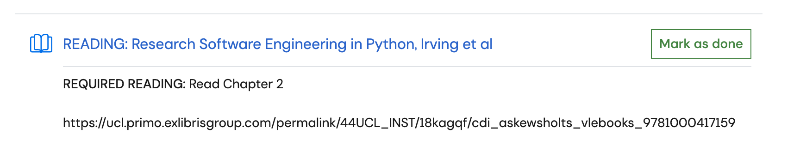

# COMP0235 Week 1 Reading — Research Software Engineering with Python

[繁體中文版](../README.md) · [Week 1 coursework](../../dict/README.md) · [Week 1 study notes](../../../dict/README.md)

**Required chapter:** Chapter 2 — *The Basics of the Unix Shell*

**Book:** *Research Software Engineering with Python: Building software that makes research possible*

**Authors:** Damien Irving, Kate Hertweck, Luke Johnston, Joel Ostblom, Charlotte Wickham, and Greg Wilson

**Publication:** CRC Press / Taylor & Francis, 2021

**Prepared:** 12 October 2026, Europe/London

These notes cover the complete Chapter 2 in the local PDF: **printed pages 13–44 (PDF pages 28–59)**, Figures 2.1–2.5, all 17 exercise prompts, and the Key Points. They were cross-checked against the [authors' public chapter](https://third-bit.com/py-rse/bash-basics.html). The outline and key points are paraphrased study notes; the reflection is an AI-assisted first-person draft for the student to review and revise.

## 1. Coursework requirements and evidence



The supplied course-requirement screenshot is preserved alongside these notes for reference.

| Item | Confirmed information | Evidence |
| --- | --- | --- |
| Module/week | COMP0235 — Engineering for Data Analysis 1, Week 1 | [Existing coursework record](../../dict/README.md); the folder retains the Data Engineering name |
| Reading resource | Moodle calls the activity **READING: Research Software Engineering in Python, Irving et al**; the official book title uses **with Python** | Supplied Moodle screenshot and existing reading record |
| Explicit lecturer requirement | **REQUIRED READING: Read Chapter 2** | Supplied Moodle screenshot |
| Assigned entry point | UCL Primo electronic book link | [UCL Library permalink](https://ucl.primo.exlibrisgroup.com/permalink/44UCL_INST/18kagqf/cdi_askewsholts_vlebooks_9781000417159) |
| Deadline, word count, submission, marking | Not specified in the screenshot; the existing coursework record also found no exact reading deadline or separate upload requirement | No additional rules inferred from the activity title |
| Additional output requested here | Chapter outline, key points, command reference, exercise themes, and reflection in `coursework/reading/README.md`, committed to GitHub | The user's request in this chat |

**Distinguishing the instructions:** Reading Chapter 2 is the course requirement shown in the screenshot. Following examples and doing exercises are the book authors' learning activities; the supplied course information does not explicitly require submitting answers to all 17 exercises. The outline and reflection are study records requested in this chat. **Mark as done** is a platform completion button; it is not evidence of assignment submission or the student's understanding.

## 2. Chapter outline

The chapter explains the CLI and shell, then develops a basic workflow: locate yourself, find data, manage files, select multiple inputs, and consult documentation. [Chapter 2](https://third-bit.com/py-rse/bash-basics.html)

| Section | Topic | Main learning point |
| --- | --- | --- |
| Introduction | GUI, CLI, REPL, shell | A shell reads commands and runs programs; text commands support recording and automation. |
| 2.1 Exploring Files and Directories | Inspecting the filesystem | `whoami`, `pwd`, `ls`; filesystem, root, home, options, and arguments. |
| 2.2 Moving Around | Navigation | `cd`; absolute/relative paths; `.`, `..`, `~`, `cd -`; hidden files. |
| 2.3 Creating New Files and Directories | Creating directories and text | `mkdir`, Nano, naming, quoting; extensions are conventions. |
| 2.4 Moving Files and Directories | Moving and renaming | `mv source destination`; destinations can be filenames or directories; overwriting matters. |
| 2.5 Copying Files and Directories | Copying | `cp` retains the source; `cp -r` includes directory contents; `scp` is mentioned for remote transfers. |
| 2.6 Deleting Files and Directories | Deletion | `rm`, `rm -r`, `-i`, `-v`; usually no recoverable trash bin. |
| 2.7 Wildcards | Selecting filenames | The shell expands patterns before running commands; batch inputs for `wc`. |
| 2.8 Reading the Manual | Documentation | `man`, `less`, some programs' `--help`, TLDR, and `wc` options. |
| 2.9 Summary | Connecting to later work | Chapter 3 introduces combining and repeating commands to build workflows. |
| 2.10 Exercises | 17 exercises | Predict paths, option effects, move/copy results, and wildcard selections. |
| 2.11 Key Points | Review | Explain the commands and shared filesystem rules. |

## 3. Key reading points

### 3.1 The shell is an interface for running programs

The shell accepts text commands through a **read → evaluate → print → loop** interaction. It can run programs written in different languages, providing a foundation for running Python analyses from the command line. Bash and zsh are shells. The book's `$` and `%` denote prompts and should not be typed as part of the commands. [Introduction and 2.1](https://third-bit.com/py-rse/bash-basics.html#bash-basics-explore)

**Interpretation:** Saving commands helps repeat operations, but command history alone does not ensure reproducible research. Data, execution order, working directory, and environment still need documenting. This is a working habit inferred from the chapter.

### 3.2 The working directory determines a relative path's meaning

Files and nested directories form a directory tree. `pwd` reports the current location, `ls` inspects contents, and `cd` changes the shell's current working directory. `ls data` does not enter `data`. [2.1–2.2](https://third-bit.com/py-rse/bash-basics.html#bash-basics-navigate)

| Notation | Meaning | Example |
| --- | --- | --- |
| `/` | Root of the filesystem | `cd /` |
| Absolute path | Starts from the root | `/Users/amira/zipf/data` |
| Relative path | Starts from the current working directory | `data`, `../docs` |
| `.` | Current directory | `mv data/draft.txt .` |
| `..` | Parent directory | `cd ..`, `cd ../..` |
| `~` | Shell-expanded home-directory shorthand | `cd ~`, `ls ~/Downloads` |
| `cd` | Returns home when no path is supplied | `cd` |
| `cd -` | Returns to the previous working directory | This use of `-` is specific to `cd` |

From `/Users/amira/zipf/docs`, `../data` refers to `/Users/amira/zipf/data`, while `data` refers to a directory beneath `docs`. Changing the starting location changes how the same relative path resolves.

The shared meanings of `.` and `..` across commands illustrate **orthogonality**. Settings files beginning with `.` are normally hidden from a plain `ls`; `ls -a` includes them.

### 3.3 Distinguish spaces, options, and filenames

A useful model is **command + options + arguments**. In `ls -F data`, `ls` is the command, `-F` changes its display, and `data` is the target directory. `ls-F` is interpreted as a different program name. Following the book's advice, place options before file/directory arguments to reduce platform differences. [2.1 and 2.3](https://third-bit.com/py-rse/bash-basics.html#bash-basics-filedir)

Prefer clear, simple new filenames without spaces, special symbols, or a leading `-`. Quote existing paths containing spaces:

```sh
ls -F "Comp0235-Data Engineering/Week1/coursework"
```

An extension helps identify a format; renaming `.png` to `.txt` does not convert an image into text. Nano edits plain text: `Ctrl+O` saves, Enter confirms the filename, and `Ctrl+X` exits.

### 3.4 Moving, copying, and deleting have different consequences

`mv` changes a location or name, `cp` creates a copy while retaining the source, and `rm` removes files. For `mv` and `cp`, the first argument is a source and the last is the destination. Multiple sources require a directory destination. `cp -r` copies contents too, rather than reproducing only an empty directory structure. [2.4–2.6 and 2.10.11–2.10.14](https://third-bit.com/py-rse/bash-basics.html#bash-basics-move)

Moving or copying can overwrite destination files; `-i` requests interactive confirmation. `-v` reports operations but does not prevent mistakes. `rm -r` recursively removes a directory and its contents, usually without a trash bin. Check `pwd` and selected paths first, and practise on disposable copies.

### 3.5 The shell expands wildcards first

For `wc data/*.txt`, the shell expands the pattern into matching filenames and passes them to `wc`. `wc` itself does not interpret the `*`. The same pattern can therefore supply inputs to different programs. [2.7, 2.10.15, and 2.10.17](https://third-bit.com/py-rse/bash-basics.html#bash-basics-wildcard)

| Pattern | Selection rule |
| --- | --- |
| `data/*.txt` | Names ending in `.txt` under `data` |
| `data/s*.txt` | Names starting with `s` and ending in `.txt` |
| `data/*_*.txt` | Names containing `_` and ending in `.txt` |
| `data/?.txt` | Exactly one character before `.txt`; `?` does not mean zero or one |
| `data/[st]*.txt` | Names starting with `s` or `t` |

`*` matches zero or more characters, normally without crossing `/` or automatically matching a leading `.`. Globbing selects names; it does not validate contents or ensure every match is a regular file. [Bash Filename Expansion](https://www.gnu.org/s/bash/manual/html_node/Filename-Expansion.html)

The final exercise's `novel-????-[ab]*.{txt,pdf}` combines exactly four characters (`????`), an `a` or `b` (`[ab]`), and a possibly empty suffix (`*`). **Brace expansion** produces the two extension patterns before filename matching. The four characters need not be a four-digit year.

**Platform clarification:** With normal Bash defaults, an unmatched pattern is passed unchanged to the program. With zsh's default `NOMATCH` behaviour, the shell usually reports `no matches found` first. Shell options can change this. [Bash manual](https://www.gnu.org/s/bash/manual/html_node/Filename-Expansion.html), [zsh manual](https://zsh.sourceforge.io/Doc/Release/Expansion.html#Filename-Generation)

### 3.6 Understand what `wc` measures

`wc` gives a quick indication of text size and accepts multiple inputs through wildcards. **Technical clarification:** Although the book describes lines, words, and characters, the usual third default count is **bytes**, not the number of Chinese or other multibyte characters. `-l` counts newlines; a final unterminated fragment does not add another line. `-w` counts whitespace-delimited sequences rather than linguistic tokens. `-m` counts characters according to the locale. [GNU `wc` manual](https://www.gnu.org/s/coreutils/manual/html_node/wc-invocation.html)

Consequently, `wc -w` is a rough size check, not a replacement for the word-frequency analysis required for the book's Zipf's Law project.

### 3.7 Consulting documentation is part of solving the problem

`man wc` provides NAME, SYNOPSIS, DESCRIPTION, options, and other sections. Some commands support `--help`; this is not universal across tools and platforms. TLDR provides concise examples that can be checked against the actual system manual. Common `less` controls include Space for the next page, `b` for the previous page, `/word` to search, `n` for the next match, and `q` to quit. [2.8 Reading the Manual](https://third-bit.com/py-rse/bash-basics.html#bash-basics-help)

## 4. Command reference

These are independent examples assuming the relevant source files and directories exist, not one script to run sequentially.

| Command | Purpose/caution |
| --- | --- |
| `whoami` | Show the current user identity. |
| `pwd` | Show the current working directory. |
| `ls -F -a` | Include hidden entries and mark types with suffixes such as `/`. |
| `ls -l -h` | Detailed listing and readable sizes; introduced in the exercises. |
| `ls -R -t` | List recursively, sorting entries within each directory by modification time. |
| `cd ../data` | Move to the parent, then into `data`. |
| `mkdir docs` | Create a directory; its parent must already exist. |
| `nano docs/draft.txt` | Open/edit a plain-text file in Nano. |
| `touch draft.txt` | Create an empty file if absent; otherwise update timestamps without clearing contents. |
| `mv -i docs/draft.txt docs/notes.txt` | Rename, asking before overwriting. |
| `cp -i docs/notes.txt backup/` | Copy a file into an existing directory. |
| `cp -r docs backup` | Copy recursively; an existing `backup` can change the resulting nesting. |
| `rm -i scratch.txt` | Ask before deleting the specified practice file. |
| `rm -r -i scratch` | Recursively remove a practice directory with interactive confirmation. |
| `ls data/*.txt` | Inspect the matched entries first. |
| `wc -l data/*.txt` | Count newlines per input and show a total for multiple files. |
| `wc -w data/novel.txt` | Count whitespace-delimited words. |
| `wc -c data/novel.txt` | Count bytes. |
| `wc -m data/novel.txt` | Count characters according to the locale. |
| `man wc` | Read the local manual. |

`ls -r` reverses sorting; `ls -R` lists recursively. The same option letter can have different meanings in other programs, so check it per command.

## 5. Learning outline for the 17 exercises

This groups the abilities developed by the prompts; reading a prompt is not recorded as completing its practical work. [2.10 Exercises](https://third-bit.com/py-rse/bash-basics.html#bash-basics-exercises)

| Exercises | Main practice |
| --- | --- |
| 2.10.1–2.10.2 | Distinguish `ls -l`, `-h`, `-R`, and `-t`: details, sizes, recursion, and ordering. |
| 2.10.3–2.10.5 | Resolve paths from a specified working directory and predict `ls` using Figure 2.5. |
| 2.10.6–2.10.7 | Understand `touch` and `rm -i`: empty files, timestamps, and deletion. |
| 2.10.8–2.10.11 | Move multiple files, rename, track copy/move destinations, and interpret multiple arguments. |
| 2.10.12 | Compare whether different patterns select the same filenames. |
| 2.10.13–2.10.14 | Organise outputs in `results`; distinguish empty directory structures from copied datasets. |
| 2.10.15–2.10.17 | Compare patterns, consider missing matches, precisely select deletions, and interpret combined expansions. |

**Self-check:** Before running a command, can you explain the current location, the arguments produced by the shell, the sources/destinations affected, and how to inspect the result?

## 6. Reading reflection draft

After reading this chapter, I have a more concrete understanding of research software engineering. Research results depend on programs and on the operations surrounding them: where data is stored, which files are selected, and how outputs are preserved. The CLI expresses those operations as text that can be inspected and repeated. For me, the chapter's main contribution is making easily overlooked file operations explicit parts of a research method.

Working directories and relative paths show that a command's meaning depends on where it runs. The same `data/*.txt` can select different data from another location or match nothing. In future coursework READMEs, I would specify the starting directory before giving commands with relative paths. This helps others understand the workflow and avoids assuming that everyone can use the paths on my computer.

Wildcards also show that a short command contains a data-selection decision. They reduce repeated typing, but the selected inputs directly affect the analysis. Extensions are naming conventions, so `.txt` or `.csv` alone cannot establish that contents are correct. Before deletion or batch processing, I would inspect matches and distinguish raw data from derived outputs, keeping the scope consistent with the research purpose.

Efficiency also requires operations that can be checked. `cp`, `mv`, and `rm` are short commands with distinct consequences: copying, relocating, and deleting. `-v` reports what happened but cannot determine whether it was appropriate. This makes me place more value on checking sources and destinations and practising with disposable data. Data-management habits affect whether errors can later be traced and analyses repeated.

Finally, `wc` highlights the difference between obtaining a number and understanding its meaning. Bytes, characters, and whitespace-delimited words are different measurements; linguistic word frequencies need further definitions. I see reading the manual as part of understanding the analysis method. My next step is to apply these path and file-management foundations to Python coursework so that my analysis workflows can be explained, checked, and rerun.

## 7. Preparation status and references

- [x] Prepared an outline, key points, command reference, and exercise themes from the complete chapter.
- [x] Prepared a reflection draft and Chinese/English versions.
- [ ] Student reviews the reflection and adapts it to their own views.
- [ ] Student practises unfamiliar commands and checks whether they can predict the results.

Document preparation is distinguished from the student's reading/practical status. Moodle completion was not changed during this task.

1. Irving, D., Hertweck, K., Johnston, L., Ostblom, J., Wickham, C., & Wilson, G. (2021). *Research Software Engineering with Python: Building software that makes research possible*. CRC Press / Taylor & Francis. Chapter 2, pp. 13–44.
2. [Authors' Chapter 2](https://third-bit.com/py-rse/bash-basics.html) / [Book and licensing](https://third-bit.com/py-rse/#contributing-and-re-use) / [Source repository](https://github.com/merely-useful/py-rse). These notes contain summaries, translations, and interpretations; the original book text uses CC BY 4.0 and its code uses the MIT licence.
3. [UCL Library entry](https://ucl.primo.exlibrisgroup.com/permalink/44UCL_INST/18kagqf/cdi_askewsholts_vlebooks_9781000417159) / [Moodle Week 1](https://moodle.ucl.ac.uk/course/section.php?id=1381270). Requirements here come from the supplied screenshot; Moodle was not revisited during this task.
4. Technical clarifications: [GNU `wc`](https://www.gnu.org/s/coreutils/manual/html_node/wc-invocation.html), [Bash Filename Expansion](https://www.gnu.org/s/bash/manual/html_node/Filename-Expansion.html), and [zsh Filename Generation](https://zsh.sourceforge.io/Doc/Release/Expansion.html#Filename-Generation); also checked the local `man wc`.
